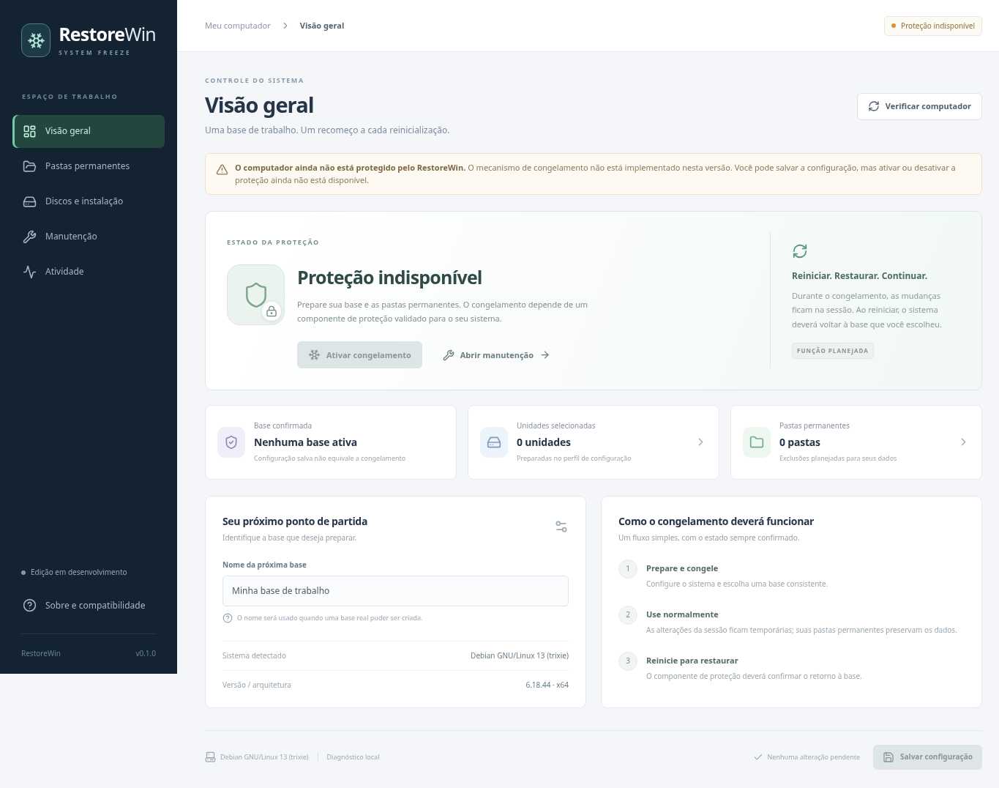

# RestoreWin

Interface desktop em português e núcleo experimental de redirecionamento em imagens. **Ainda não contém um mecanismo que congele ou restaure um Windows/Linux instalado, um driver instalável ou um reparador de boot.** Os controles de proteção permanecem indisponíveis; salvar uma configuração não ativa congelamento.

O objetivo confirmado foi ampliado para a **instalação física do Windows 10, Windows 11 e Linux**, começando os alvos Linux por Ubuntu/Debian. O UWF não é um recurso suportado em Home/Pro; não será instalado à força nessas edições. Uma VM de laboratório será necessária para testes, não como substituição da instalação física solicitada. Não há compatibilidade universal comprovada com todas as builds, edições, kernels ou distribuições.

Os binários proprietários recebidos foram usados para análise estática fora deste repositório. Não foram modificados nem incorporados ao código.

## Downloads da interface

Os pacotes serão disponibilizados na [pré-versão `interface-v0.1.0-preview.2`](https://github.com/SpinolaKW/RestoreWin/releases/tag/interface-v0.1.0-preview.2) quando o [workflow de empacotamento](https://github.com/SpinolaKW/RestoreWin/actions/workflows/interface-release.yml) terminar com sucesso. Se não houver arquivos na pré-versão, consulte o resultado do workflow: o link não comprova que uma publicação foi concluída. O código também pode ser baixado pelo botão **Code → Download ZIP** do GitHub.



Leia os [limites e instruções da pré-versão](docs/releases/interface-v0.1.0.md). A imagem mostra a interface executada no Linux; os downloads não fornecem congelamento real.

## Interface desktop

A interface tem visão geral, seleção de unidades, pastas permanentes, manutenção e histórico. As configurações são persistidas localmente com cópias anteriores e controle de revisão. O processo principal valida pastas, links, raízes do sistema e unidades indisponíveis. A efetivação das exclusões durante um congelamento real continua pendente.

```sh
cd desktop
npm ci
npm run install:runtime
npm run build
npm start
```

O instalador Windows está configurado para permitir escolher a pasta/unidade de destino. O pacote portátil Linux permite escolher o local de extração. O local da interface é independente das unidades selecionadas para proteger. Nenhum pacote atual instala filtros de disco, altera BCD/EFI, aplica OverlayFS ou ativa proteção.

Durante o congelamento desejado, as alterações da sessão deverão funcionar temporariamente e ser descartadas ao reiniciar, preservando pastas permanentes. A manutenção deverá permitir atualizações e preparar uma nova base. Esse comportamento ainda depende dos componentes de sistema.

Foram verificados 43 testes no Linux: 14 C, 9 Python, 16 Node e 4 fluxos reais Electron. Os fluxos desktop incluem salvar configurações, fechar/reabrir o aplicativo, adicionar/remover pastas, remover seleção desconectada e recusar ações de proteção inexistentes. Não são testes de boot nem de congelamento real.

```sh
make test-all                # C, Python e Node; requer dependências desktop
cd desktop
npm run build               # TypeScript e bundles
npm run test:ui             # Electron; requer uma sessão gráfica
```

Consulte [desenvolvimento e pacotes da interface](desktop/README.md) e [requisitos multiplataforma](docs/produto-multiplataforma.md). A interface foi executada no Debian 13 x64; execução Windows e boot dos sistemas de destino continuam sem validação. No navegador, `npm run dev` mostra uma prévia explicitamente identificada, com discos de exemplo e armazenamento apenas no navegador.

## Núcleo experimental de redirecionamento

`core/restorewin.c` implementa leitura combinada de base + overlay, gravações somente no overlay, checksums, replay e limites de capacidade. O núcleo é C11, sem alocação dinâmica nem acesso direto a arquivos ou dispositivos. Os adaptadores de teste trabalham exclusivamente em memória e arquivos temporários. O núcleo só possui uma interface de leitura para a base.

```sh
make test
```

Requisitos de teste: Python 3.10+, Make e compilador GCC/Clang com AddressSanitizer/UndefinedBehaviorSanitizer. O teste com arquivos temporários utiliza APIs POSIX e foi executado no Linux; não é um teste do Windows. Há 14 testes do núcleo e 9 do verificador PE.

As falhas de I/O desativam o contexto em memória. Um journal incompleto ou danificado impede a abertura; não há retorno silencioso à base nem reparo automático. Isso preserva a distinção entre dados verificados e desconhecidos, mas **não resolve ainda a disponibilidade após uma interrupção real de energia**. A recuperação de metadados é um requisito pendente antes de qualquer driver de boot. Um write que retornou erro pode ter sido inteiramente persistido; os testes contemplam esse resultado incerto.

Não há reset de uma imagem montada. O teste de retorno à base fecha o contexto e abre um overlay novo, mantendo o anterior intacto. Consulte [a arquitetura e os bloqueios para uma versão instalável](docs/arquitetura.md) e [o formato experimental](docs/formato-overlay.md).

## Verificação inicial dos drivers

Python 3.10+ e biblioteca padrão:

```sh
python3 -m unittest discover -s tests -v
python3 tools/check_driver_images.py /caminho/driver.sys
```

O verificador lê cabeçalhos PE sem carregar os arquivos. Ele identifica alguns obstáculos à compatibilidade com HVCI, como seções graváveis e executáveis. Retorna 0 quando essas verificações estáticas passam, 1 para achados bloqueantes e 2 para erros de leitura/formato. Nenhum desses resultados certifica compatibilidade com Windows, confiança da assinatura, correção do comportamento em execução ou segurança dos dados.

Todos os drivers candidatos ainda precisam de validação no Windows 11 25H2, incluindo HVCI/Driver Verifier, assinatura aceita pelo Windows, instalação, reinicializações, restauração, manutenção/atualizações e desinstalação. Este ambiente Linux não executa esses testes.

## Limites do projeto

- A versão antiga já foi associada pelo usuário a uma falha de inicialização; nenhuma causa específica foi confirmada em execução.
- Alterar os bytes assinados dos drivers originais invalida as assinaturas correspondentes.
- Bloquear permanentemente o Windows Update não é um mecanismo de correção de compatibilidade.
- Qualquer protótipo de armazenamento deverá começar com arquivos de imagem e máquinas descartáveis; o disco do Windows principal não é um alvo inicial de teste.
